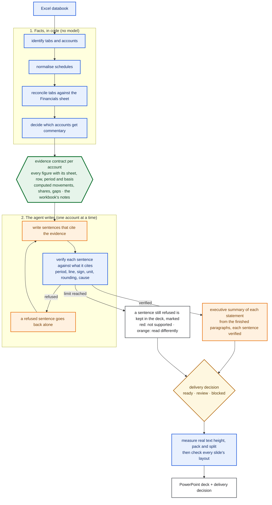

# Financial Due Diligence (FDD) Tool

Financial commentary from Excel databooks: the workbook is read and reconciled in code, an
agent writes each account from its own evidence, every sentence is checked against the
workbook before it can reach a slide, and the result is exported to PowerPoint.

---

## Public source and private settings

This public repository contains the application and fictional demo responses.
Keep client workbooks, run archives, templates and credentials outside Git.
The GitHub Download ZIP workflow remains supported. When replacing the code
folder, retain `fdd_utils/config.yml`, `fdd_utils/template.pptx` and local run
data separately, then restore them to the same paths.

Enterprise gateway routing header names are configured under the provider's
`header_names` mapping (`charge_code` and `region_override`). Set the actual
names only in the private config. The public example intentionally leaves this
mapping empty. Preserve your existing credential and routing values.

Apply the separately supplied private additions once, after restoring your
existing config (the command makes no model requests and saves a `.bak`):

```sh
python apply_private_settings.py fdd_utils/config.yml private-config-additions.yml
```

Keep the additions file private; it is excluded from Git. Later code-only ZIP
updates continue to use the same private config and template paths.

Optional `pptx.source_labels.en` and `.zh` retain per-machine attribution.
Without them, exports use a generic independent-analysis caption.

## Quick Start

```bash
pip install -r requirements.txt
streamlit run fdd_app.py
```

Upload a databook, set the entity and the Financials sheet, press **Process Data**. The reading and reconciliation cost
nothing; the commentary then starts by itself and **is paid for** (the model in the sidebar's dropdown writes every account in
scope). The dropdown starts on the model named by `default` in `config.yml`; Flash is enough for the whole report, Pro is there
when a person wants the stronger one. The same run from the command line: `python fdd_agent.py book <databook.xlsx> --model
<provider> --model-name <id>`.

---

## How a databook becomes a deck



The model never does arithmetic and never decides whether a sentence is right: the verifier does, from the figures the sentence cites.
A sentence the writer cannot get right is not dropped or smoothed over; it stays in the deck, coloured, and the file is labelled
`_DRAFT-BLOCKED` or `_REVIEW` so nobody mistakes it for a finished deliverable.

---

## Architecture

The big modules are **packages**; each `__init__.py` re-exports what a flat module would, so `from fdd_utils.pptx import X` works.

| Module | Responsibility |
|--------|---------------|
| `fdd_utils/workbook/` | Workbook profiling, sheet resolution, normalisation, reconciliation, which accounts get commentary |
| `fdd_utils/ai/` | Model configuration and the dropdown, the model client, the evidence contract, the claim verifier |
| `fdd_utils/agent/` | The agent: `book.py` (a whole databook), the controller and its tools, sessions, routing and budgets, the deck export and delivery |
| `fdd_utils/pptx/` | Payloads, packing, tables, text measurement, slide generation |
| `fdd_utils/ui/` | The Streamlit app: sidebar, processed view, the commentary run, the agent workbench panel, batch |
| `fdd_utils/mappings.yml` | Account definitions: key, statement type, category, aliases, reference sentences |
| `fdd_utils/config.yml` | Runtime config (providers, agent limits, PPTX tuning). Per-machine, not tracked; `config.example.yml` is its shape |

Entry points at the repo root:

- `fdd_app.py`: the app. One databook, or several at once (batch: one deck each, a ZIP and a combined deck).
- `fdd_agent.py`: the agent from the command line: `book` (the whole databook), `ask`, `edit`, `chat`, `report`, `export`, and the free
  commands (`summary`, `diff`, `deck`, `strip`). A session can be kept in a file and continued.
- `inspect_databook.py`: what the reader made of a workbook, tab by tab (free); with `--run-ai --export-pptx` the same run as the app.
- `inspect_pptx.py`: geometry and overflow checks on an exported deck. `inspect_render_truth.py` drives real PowerPoint over COM on
  Windows and is the only tool that reaches actual ground truth.
- `ad-hoc/workbench/`: the measuring tools and the offline gate (`migration_checks.py`, free, no model).

---

## Methodology

### 1. Facts are compiled before prose

Movements, percentage changes, shares, gaps between a tab and the Financials sheet, and sums are computed in code, and each is
given an id the writer can cite. A number the writer derives itself has no source to be checked against, which is where invented
figures come from. A sentence has to cite the facts it rests on, and what it says has to be what they say.

### 2. The judge is arithmetic, not a model

Every sentence is checked against the facts it cites: the period it puts a figure under, the line, the sign, the unit, the rounding
to the printed precision, a percentage's base, a cause resting on a cited note or marked as inference. A model-judged loop can be
talked round by a confident rewrite; a sum cannot. Where the verifier can only say "refused for how the prose was read" (which
period a figure sits under, what a rest is made of), the agent is asked to read the sentence figure by figure and Python holds that
reading to the evidence; the stronger model does it when one is configured.

### 3. Attempts are bounded, and nothing is hidden

A refused sentence goes back to the writer alone, up to a limit. After that it stays in the deck, marked, and the delivery decision
names the account and blocks the deck. A paragraph that is all verified but left out something that must be said (a material note, the
latest balance) is blocked the same way. The cost of a run is capped by a guard per account, not by a quota that could stop a model
half way.

### 4. Nothing is learned between runs

Nothing a person did to one deck changes the next. What is kept is explicit and local: a session file (`--session`), and one case file
for every account that ended a run with a refused sentence (`fdd_utils/output/agent_issues/`, git-ignored), which
`python ad-hoc/workbench/issue_cases.py replay` reads again with the verifier as it is now, free and without the workbook. A fix to the
verifier is judged on what the paid runs produced, not on the next paid run.

### 5. Every rule that matters lives in code, not only in a prompt

A rule that exists only as prompt text is a preference. Where a convention is load-bearing (a zero balance read as "no balance", units and
decimals, the period an amount belongs to) it is enforced by the verifier or the exporter after the model is finished.

---

## Known limits

- **A verified sentence is not a good paragraph.** The verifier holds figures, periods, signs, units and cited causes to the evidence. It
  does not judge whether a paragraph says what a reader needs, and a cause the notes do not give is marked as inference, not supplied.
  `methods.md` sections 4 and 8 say what was measured and what was not.
- **Extraction depth is the real ceiling.** When a workpaper's breakdown does not survive extraction, no verification or prompting
  recovers it. That is a per-firm structural problem.
- **Layout can only be confirmed in real PowerPoint.** Every check in this repo except `inspect_render_truth.py` compares the model
  against itself, so a clean `inspect_pptx.py` run is not evidence that PowerPoint agrees.
- **The offline checks do not cover a model.** `migration_checks.py` and `baseline_snapshot.py` use a scripted writer: they prove the code
  does what it did, on real workbooks, and say nothing about how a model writes.

See [`methods.md`](methods.md) for the checks in detail and what each claim rests on.

---

## Run

```bash
streamlit run fdd_app.py                                                  # the app
python fdd_agent.py book <databook.xlsx> --model dashscope --model-name <id>   # the same run, from the command line
python inspect_databook.py <databook.xlsx>                                # free diagnostics
python inspect_databook.py <databook.xlsx> --run-ai --export-pptx         # diagnostics, then the agent run and the deck
python inspect_pptx.py <deck.pptx>                                        # geometry checks
python ad-hoc/workbench/migration_checks.py                               # the offline gate (free)
```
